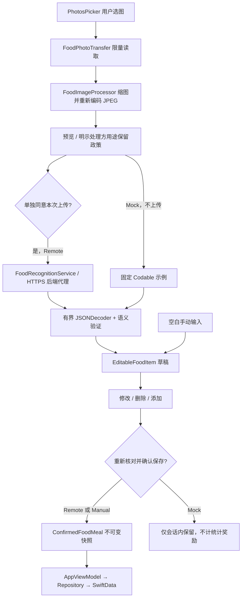

# AI 食物识别模块

## 范围与入口

iOS 17+ / Swift 5 / Xcode 16+，纯系统框架。入口：**健康 → 饮食与食物识别 → 添加饮食记录**。

当前交付是完整 Swift 客户端，不包含部署好的后端或模型供应商账户。默认使用 `MockFoodRecognitionService`；真实识别必须由应用装配层注入 `RemoteFoodRecognitionService`、实际代理地址和有效应用会话令牌来源。不能将供应商 API Key 填入客户端、配置文件、资源包或构建参数。

完整 Swift 文件及依赖见 [FILES.md](FILES.md)。新文件自动纳入 Xcode 16 的同步目录，无需逐个加入 Target。

## 架构与数据流



- `FoodRecognitionService` 提供 `mode`、`uploadNotice` 和异步 `recognize(image:requestID:)`。UI 不直接请求网络；服务不接触 SwiftData。
- `FoodRecognitionViewModel` 管理照片及草稿临时状态，使用 generation UUID 隔离旧任务结果。取消、重选、清空或进入手动模式后，旧成功/错误回调都不能覆盖新状态。
- 上传同意和保存确认是两道独立门槛。识别不会保存；结果、餐别、日期发生变化会清除核对勾选。每次请求结束清除上传同意。
- `ConfirmedFoodMeal.confirm` 验证确认标志、日期、条目数量/唯一性及输入；构造不可变值快照。该门槛不是认证机制，服务的其他调用方也必须自行取得有效上传同意。
- `AppViewModel.saveConfirmedMeal` 再次拒绝 Mock、校验日期，按餐食 UUID 去重。非 Mock 已确认餐食可完成 UTC 今日的记录任务（10 XP），餐食与奖励在同一写入事务中保存，失败整体回滚；不自动保存半成品。删除餐食不撤销已发 XP，来源凭据阻止同一 UUID 重放发奖；详见 [GOALS_HEALTH_WATCH.md](GOALS_HEALTH_WATCH.md)。
- `FoodRecord` 拥有多个 `FoodItem`，删除餐食会级联删除条目。历史记录仅本机可见，无家庭共享。数据库不保存图片或原始服务响应。
- “修改/删除/添加识别结果”作用于确认前草稿。历史页支持详情和整餐删除；本轮不提供已保存餐食的二次编辑表单。

## 图片边界

| 项目 | 约束 |
|---|---|
| 原始文件读取 | 分块读取，最多 20 MiB，额外读取 1 字节用于判断超限；不先加载整个未知大小原图 |
| 支持格式 | JPEG、PNG、HEIC、HEIF；只处理第一帧 |
| 原图像素 | 不超过 80,000,000 像素，解码前检查尺寸 |
| 输出长边 | 最大 1,600 px，应用原始方向变换 |
| 输出内容 | 从像素新建 JPEG，不复制源 EXIF/GPS 元数据 |
| 上传 JPEG | 最大 4 MiB，压缩质量依次降低仍超限则拒绝 |
| 代理请求 | Base64 后约 5.34 MiB，加 JSON 开销；后端须设置匹配的请求限制 |
| 代理响应 | 最大 256 KiB，检查 Content-Length，同时逐字节限制实际响应 |

App 不主动落盘照片；系统 PhotosPicker/文件提供方可能产生自己的临时文件或下载选中照片。取消不能保证中断单次 ImageIO 内部解码，也不能撤回后端已经收到的数据。清理内存副本不删除图库原图、不代表服务端删除，也不承诺内存安全擦除。

## 代理 HTTP 协议

开发方配置完整的 HTTPS POST 地址（例如自有域名下的 `/v1/food/recognize`）。拒绝 HTTP、URL 内用户名/密码、查询串、fragment 及空路径。

请求头：

- `Content-Type: application/json`
- `Accept: application/json`
- `Authorization: Bearer <短期应用会话令牌>`：由注入的异步令牌提供方取得，不是 AI 供应商 API Key。
- `Idempotency-Key: <UUID>`：与正文 requestID 相同；同一次操作重试时稳定。

请求 JSON：

```json
{
  "requestID": "同 Idempotency-Key 的 UUID",
  "imageBase64": "经过本机处理的 JPEG 的 Base64",
  "mimeType": "image/jpeg"
}
```

成功状态须返回 `application/json`：

```json
{
  "mealType": "lunch",
  "foods": [
    {
      "name": "米饭",
      "cookingMethod": "蒸煮",
      "servingDescription": "一碗，请核对分量",
      "estimatedWeightGrams": 180,
      "estimatedCalories": 210,
      "calorieRange": { "lower": 180, "upper": 250 },
      "proteinGrams": 4.5,
      "carbohydrateGrams": 46,
      "fatGrams": 0.5,
      "confidence": 0.7,
      "questions": ["请确认实际重量和是否有额外用油。"]
    }
  ],
  "totalEstimatedCalories": 210,
  "disclaimer": "估算结果仅供记录参考。"
}
```

### Codable 与语义验证

- `mealType`：breakfast / lunch / dinner / snack；`foods`：1—30 项，空数组表示无法识别。
- `name` 必填、非空，最长 120 字；cookingMethod 最长 120 字、servingDescription 最长 200 字。
- 重量、热量、三大营养素都为 JSON number，不接受字符串数字。未知可省略或为 null，不会补成 0。重量若提供须大于 0；各数值有限且不超过 20,000。
- 每个识别结果必须提供热量点估值或上下限范围之一。范围须完整且有序，点估值存在时须位于范围内。只返回范围时绝不取中点补齐；手动记录允许全部营养数据留空。
- confidence 可省略，提供时须在 0—1；仅显示未校准原始分值，不称作准确率。questions 最多 8 条，每条最长 300 字。
- totalEstimatedCalories 可省略，若提供须为有限的 0—600,000 数值。UI/保存不信任服务器合计，以用户确认条目重算，未知项目标注小计不完整。
- disclaimer 最长 1,000 字；UI 使用应用自有健康提示，远程名称/问题作为纯文本展示，不解释为 Markdown、指令或可执行内容。
- 忽略未知扩展字段；拒绝必填字段缺失、错误类型、非法餐别、非有限数、超长字段及超限响应。入口统一使用 `FoodRecognitionResponse.decode`，而非只调用未附语义验证的 JSONDecoder。
- 未修改字段保存原始 Double 值；编辑字段重新解析和验证。显示格式不应被用作原始数值的替代。

## 网络与错误

`URLSessionFoodHTTPTransport` 使用每次请求独立的 ephemeral session，不启用 URLCache、Cookie 或凭据存储，拒绝全部重定向（包括同源），结束/取消后 invalidateAndCancel。默认请求和资源超时 30 秒，可配置为大于 0 且不超过 60 秒；该限制不包含调用方令牌获取耗时。

| 情况 | 客户端错误 |
|---|---|
| 无网络 / 断网 / 网络访问不允许 | offline |
| URLSession 超时，HTTP 408 / 504 | timeout |
| 本机图片超限 / HTTP 413 | imageTooLarge |
| 坏图 / 不支持的格式 | invalidImage |
| HTTP 422 / foods 空数组 | unrecognized |
| HTTP 401 / 403 | unauthorized |
| HTTP 429 | rateLimited |
| 其他 5xx | serverUnavailable |
| 响应超限 | responseTooLarge |
| 非 JSON、错类型、重定向或其他无效响应 | malformedResponse |
| 用户取消 | cancelled，不作为失败警报展示 |

错误仅暴露受控中文提示及 `FOOD_*` 错误码，不展示原始响应、内部异常、令牌或服务端堆栈。用户可以重试或新建空白手动记录；不会暗中把失败结果替换为 Mock 后存为真实记录。

默认 **不自动重试**。只有确认后端按“用户身份 + Idempotency-Key”可靠去重后，才能显式开启幂等重试；最多对 502/503/504 重试一次，间隔 250ms。网络超时/断线、401、429 不自动重试。新选图/清空会创建新操作 ID；重试不能绕过新的上传同意。

## 接入真实识别

在 [GoalPetApp.swift](../GoalPet/App/GoalPetApp.swift) 的装配流程中：

1. 从开发方受控配置获得真实代理 HTTPS 地址；不得允许用户随意输入任意上传目标。
2. 提供实际处理方、用途、保留/删除政策和 HTTPS 隐私链接，不能用示例政策冒充。
3. 构造 `RemoteFoodRecognitionService.Configuration`，默认保持不重试。
4. 构造服务并注入 `accessToken` 异步闭包，由应用认证层返回短期令牌；认证层是尚待实现的依赖。闭包须可取消、避免无限等待，不记录令牌。
5. 传入 `AppViewModel(repository:now:foodRecognitionService:)`。不改 UI、不在 View 中拼请求。
6. 独立验证测试环境后端及隐私行为；无法配置时应保持明确的 Mock 或阻止远程模式，不静默使用其他供应商。

### 后端必须承担的职责（本仓库未实现）

- 校验应用用户身份和调用授权；按用户限流、配额、计费保护，不能只依赖客户端标志。
- AI 供应商 API Key 只保存在服务端秘密管理中；不要将其返回客户端。
- 校验请求体大小、Base64、JPEG 实际内容及像素上限；不要信任客户端 MIME 和尺寸。
- 调用供应商并将响应规范化为上述结构；服务端也应执行 JSON Schema/数值检查，防止直接透传原始模型文本。
- 按声明的目的及期限处理、删除照片；禁止日志记录图片/Base64/访问令牌，脱敏错误与追踪记录。
- 若启用重试，按用户隔离幂等记录，绑定请求正文，防重复推理/收费，并定义重放有效期。
- 配置正确 HTTP 状态、JSON MIME、请求超时和响应上限；不要把私密图片放进公共 URL。

## 测试与发布前验证

饮食模块保留 72 个 XCTest 方法：解析/数值/范围/未知值/精度、确认和绑定失效、Mock 隔离、显式保存和级联删除、图片元数据/大小、上传同意及过期回调、代理 JSON/头部/错误映射/重试/取消。全仓库现为 305 个：47 基线 + 72 饮食 + 50 引擎 + 23 集成 + 37 HealthKit + 63 Watch + 13 家庭；本轮功能扩展新增 186 个，本次文档更新未新增或执行测试。

**Windows 上未运行 Xcode、模拟器或 XCTest，不能据此声称编译或测试通过。** 当前检查包括源代码审查、文件引用、结构/JSON/XML 和 whitespace 检查。代理测试替换了传输层，并未验证真实 URLSession 流式行为或真实模型。

在 Mac / CI 必须补验：

- Xcode build / Product → Test；iOS 17 和支持的最新 iOS。
- 实际 PhotosPicker 的 HEIC、EXIF 方向、iCloud 下载失败/取消、超大原图、多次快速换图。
- 真实 HTTPS 测试代理的重定向拒绝、未知/错误 Content-Length、流式超限、头部/正文期间取消、401/429 和超时；检查图片/令牌没有到达重定向目标。
- VoiceOver、大字体、深色模式，确认不可跳过、修改后需重新确认；保存失败草稿仍保留。
- 持久磁盘库重启与旧版库升级。此前新增 `FoodRecord`/`FoodItem` 及关系，本轮另增 `RewardEvent` 和 `HealthGoal.statusRaw`，均未提供已验证的版本化迁移；需在旧库副本上验证并制定迁移计划，保留 UUID 与奖励凭据，不能删除用户旧库绕过错误。

照片估算无法保证重量、用油量或营养值准确。页面明确提供人工修正，不生成医疗诊断、饮食处方或摄入目标。